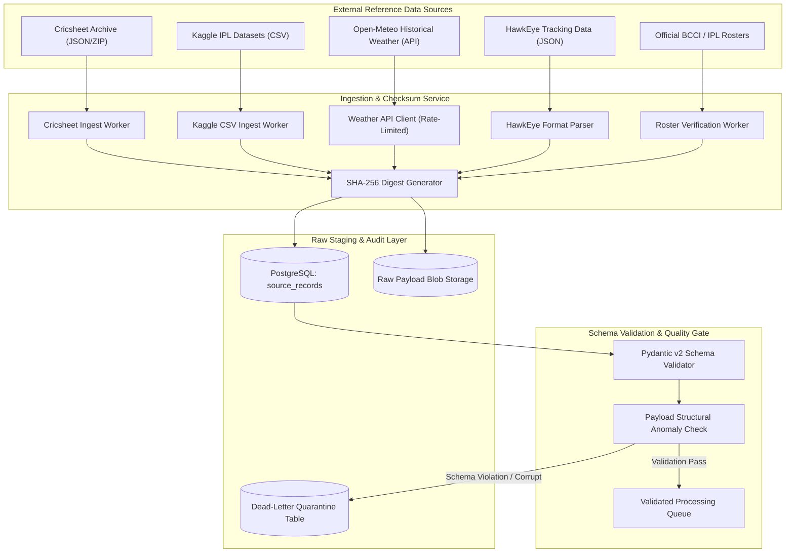
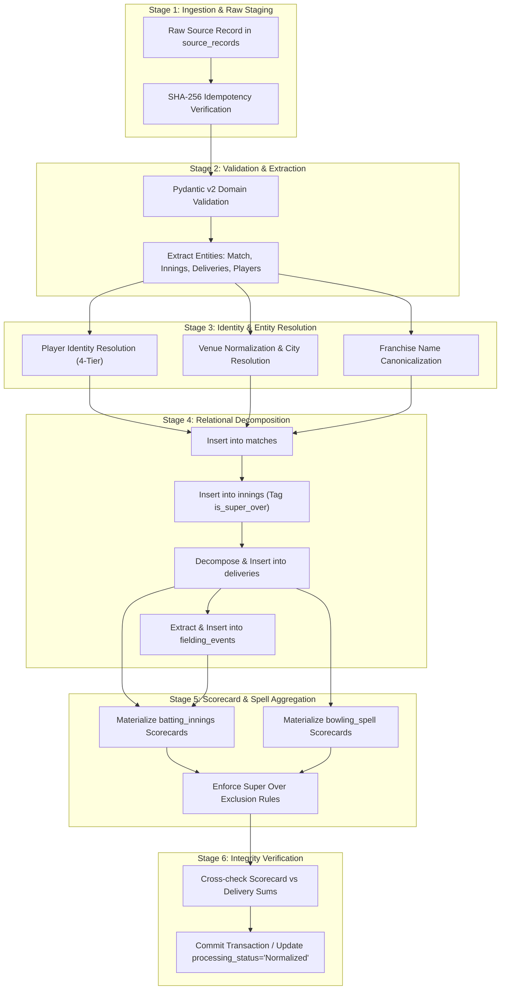
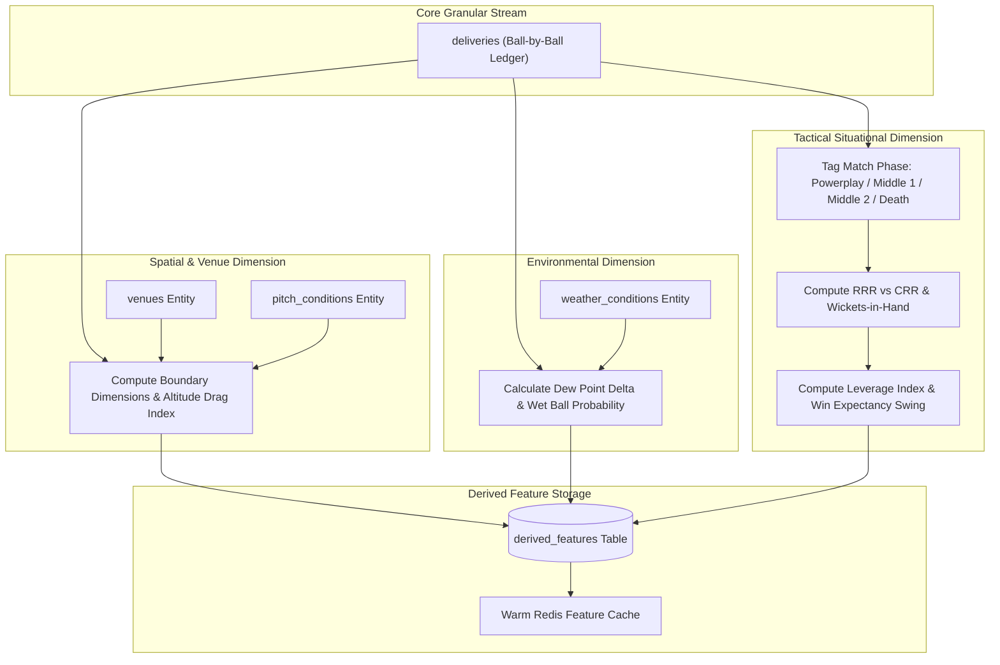
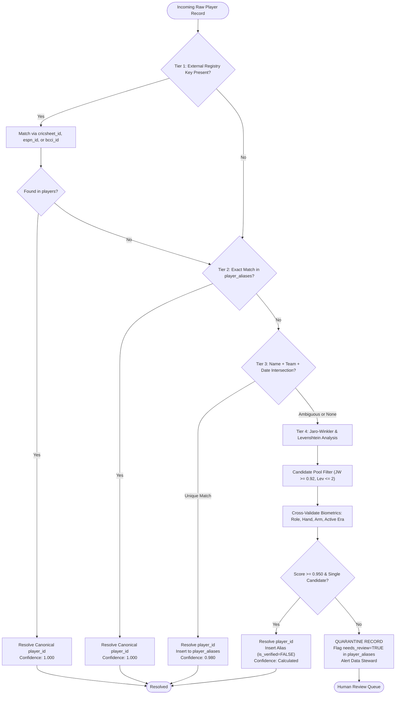
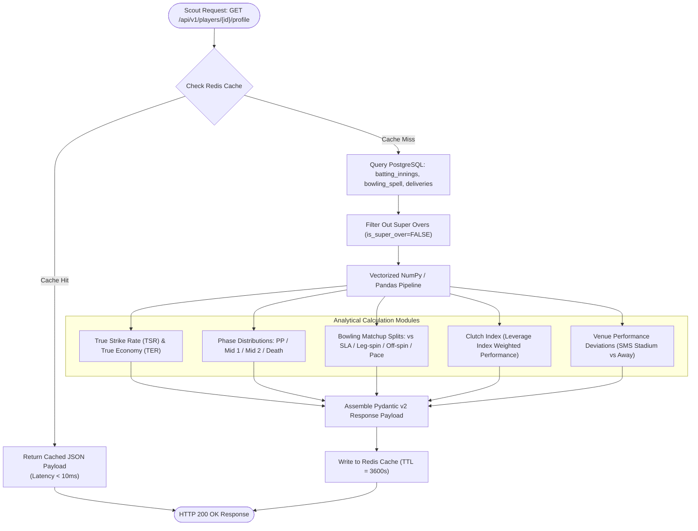
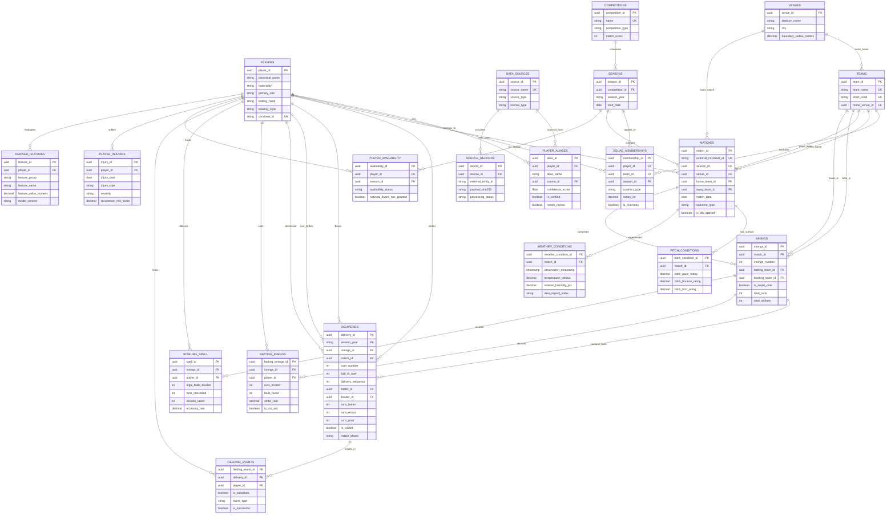
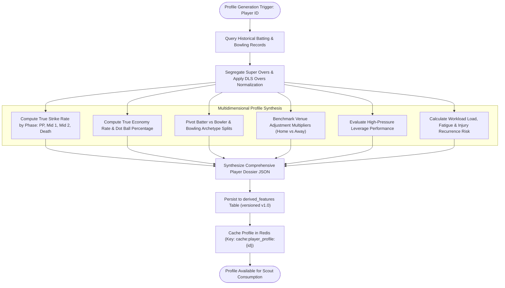
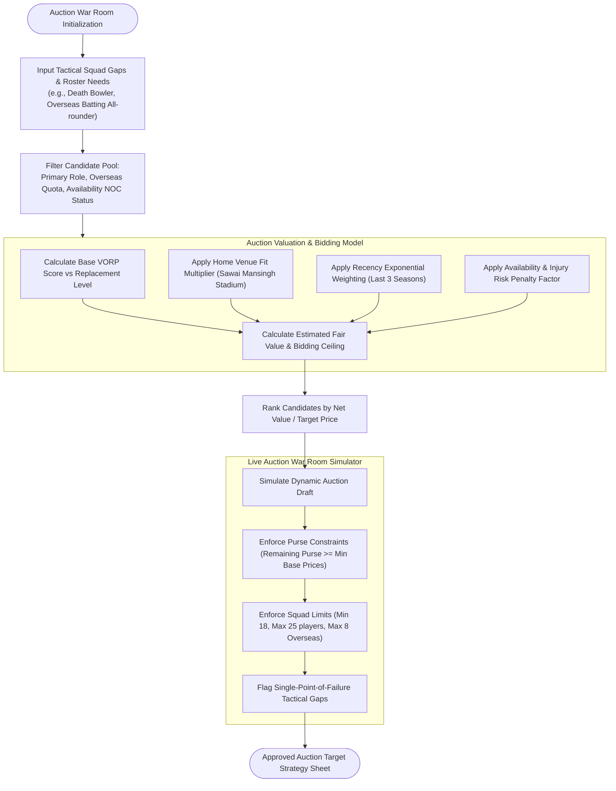
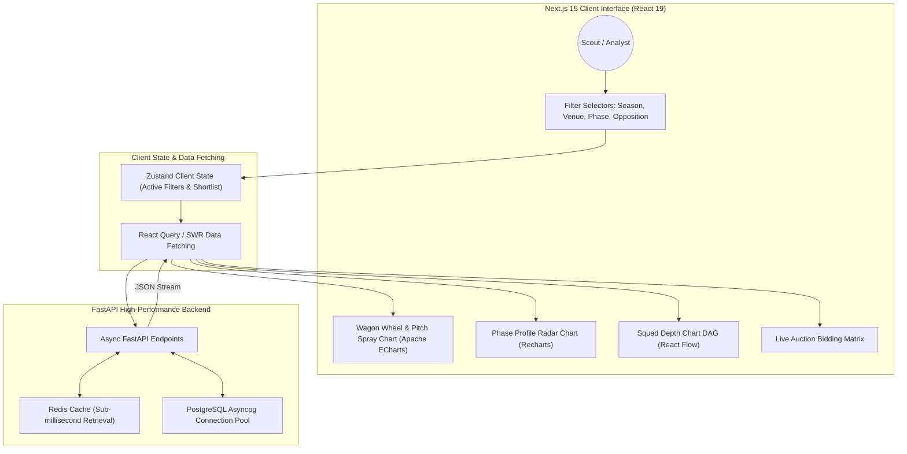

# System Architecture & Technical Design Specification
**Rajasthan Royals Squad Intelligence & Historical Performance Engine**  
**Tournament**: Indian Premier League (IPL) 2027 Auction Preparation & Tactical Engine  
**Document Version**: 1.0.0 (Engineering Baseline)  
**Status**: [STATUS: PLANNED - GREENFIELD BASELINE]  
**Author**: Engineering Architecture Team (`teamwork_worker_2`)  

---

## 1. Architectural Overview & Design Principles

> **Architecture Baseline Status**: `[STATUS: PLANNED - GREENFIELD BASELINE]`  
> All 10 architectural diagrams, data flows, entity relationship diagrams, and Architectural Decision Records (ADRs) depict the approved target state for greenfield engineering.

The Rajasthan Royals Squad Intelligence & Historical Performance Engine is architected as a distributed, high-performance analytical system designed for tactical decision support during the IPL 2027 auction and campaign planning `[STATUS: PLANNED - GREENFIELD BASELINE]`. The architecture is guided by six core engineering principles:

1. **Deterministic Reproducibility**: Every metric, feature vector, and valuation must be fully reproducible from raw source payloads accompanied by SHA-256 cryptographic digests.
2. **Strict Third Normal Form (3NF) Relational Core**: Data integrity is paramount. Hard foreign key constraints, composite unique indexes, and domain check constraints prevent corrupt data from propagating into tactical decisions.
3. **Decoupled Analytical Feature Store**: Pristine historical scorecard ledgers are segregated from machine learning projections and valuation models via `derived_features`.
4. **Declarative Partitioning for Scalability**: The high-volume delivery stream (>250,000 deliveries) is partitioned declaratively by season to ensure partition pruning and sub-50ms query responses.
5. **Multi-Tier Identity Resolution**: Player name variations across disparate providers are resolved using a deterministic-to-probabilistic 4-tier waterfall anchored by Cricsheet registry hashes.
6. **Domain-Specific Cricket Integrity**: Cricket rules (MCC Laws & IPL Playing Conditions) are hard-coded into database and API contracts: Super Overs are segregated, DLS revised targets are normalized, penalty runs are excluded from bowler charges, and missing data evaluates to `NULL` rather than fabricated zeros.

---

## 2. Complete System Architecture Diagrams (10 Mermaid Specifications)

All 10 diagrams below adhere strictly to Mermaid syntax standards, utilizing unique node identifiers, escaped labels, and explicit directional connections.

---

### 2.1 Diagram 1: High-Level System Architecture

```mermaid
flowchart TD
    subgraph Client_Tier["Client Presentation Layer (Next.js 15 / React 19)"]
        UI_Dashboard["Scouting Dashboard & War Room UI"]
        UI_PlayerProfile["Player Profile & Spray Maps"]
        UI_MatchupMatrix["Batter vs Bowler Matchup Matrix"]
        UI_AuctionSim["Auction Bidding & Purse Simulator"]
        UI_SquadDepth["Squad Depth Chart (React Flow)"]
    end

    subgraph API_Gateway["API & Orchestration Layer (FastAPI / ASGI)"]
        Gateway["FastAPI Async Gateway (Uvicorn Workers)"]
        Auth["RBAC & Session Management"]
        Router_Player["Player Analytics Router"]
        Router_Scouting["Auction Scouting Router"]
        Router_Match["Match & Delivery Router"]
        Redis_Cache[("Redis 7 In-Memory Cache")]
    end

    subgraph Analytical_Engine["Analytics & Computation Engine (NumPy / Pandas)"]
        Engine_VORP["VORP & Valuation Calculator"]
        Engine_Phase["Phase & Situational Aggregator"]
        Engine_Matchup["Head-to-Head Matchup Engine"]
        Engine_Simulation["Monte Carlo Auction Simulator"]
    end

    subgraph Storage_Tier["Central Data Store (PostgreSQL 16)"]
        DB_Relational[("PostgreSQL Normalized Core (20 Entities)")]
        DB_Partitioned[("Partitioned Deliveries Ledger")]
        DB_Features[("Derived Feature Store")]
        DB_Staging[("Source Records & Audit Log")]
    end

    subgraph Ingestion_Tier["Data Acquisition & ELT Pipeline"]
        Ingest_Cricsheet["Cricsheet JSON Loader"]
        Ingest_Kaggle["Kaggle Historical CSV Parser"]
        Ingest_Weather["Open-Meteo Weather API Worker"]
        Ingest_Hawkeye["HawkEye Ball Tracking Importer"]
        Engine_Identity["Multi-Tier Identity Resolution Engine"]
    end

    UI_Dashboard --> Gateway
    UI_PlayerProfile --> Gateway
    UI_MatchupMatrix --> Gateway
    UI_AuctionSim --> Gateway
    UI_SquadDepth --> Gateway

    Gateway --> Auth
    Auth --> Router_Player
    Auth --> Router_Scouting
    Auth --> Router_Match

    Router_Player <--> Redis_Cache
    Router_Scouting <--> Redis_Cache

    Router_Player --> Engine_Phase
    Router_Player --> Engine_Matchup
    Router_Scouting --> Engine_VORP
    Router_Scouting --> Engine_Simulation
    Router_Match --> DB_Partitioned

    Engine_VORP <--> DB_Features
    Engine_Phase <--> DB_Partitioned
    Engine_Matchup <--> DB_Partitioned

    Ingest_Cricsheet --> DB_Staging
    Ingest_Kaggle --> DB_Staging
    Ingest_Weather --> DB_Staging
    Ingest_Hawkeye --> DB_Staging

    DB_Staging --> Engine_Identity
    Engine_Identity --> DB_Relational
    Engine_Identity --> DB_Partitioned
```

---

### 2.2 Diagram 2: Data Ingestion Architecture

---

### 2.3 Diagram 3: Raw-to-Normalized Data Pipeline

---

### 2.4 Diagram 4: Contextual Enrichment Architecture

---

### 2.5 Diagram 5: Player Identity Resolution Workflow

---

### 2.6 Diagram 6: Player Analytics Workflow

---

### 2.7 Diagram 7: Central Database Entity Relationship Diagram (ERD Covering All 20 Entities)

---

### 2.8 Diagram 8: Player Profile Generation Workflow

---

### 2.9 Diagram 9: Candidate Evaluation & Auction Scouting Workflow

---

### 2.10 Diagram 10: Dashboard Interaction & UI Component Architecture

---

## 3. Architectural Decision Records (ADRs)

### ADR-001: Adoption of PostgreSQL 16 3NF with Declarative Season Partitioning
- **Status**: APPROVED ARCHITECTURAL TARGET `[STATUS: PLANNED - GREENFIELD BASELINE]`
- **Context**: The engine must store and analyze over 250,000 granular delivery rows from 2008 to 2026. A non-relational document store (e.g., MongoDB) introduces significant risks of inconsistent player names, invalid run counts, and difficult multi-table analytical joins.
- **Decision**: Adopt PostgreSQL 16 with a strict Third Normal Form (3NF) relational core spanning 20 entities. The high-volume `deliveries` table utilizes declarative list partitioning on `season_year`.
- **Consequences**: Guarantees referential integrity, eliminates orphaned records, and enables partition pruning so queries targeting a specific season scan only that partition's tablespace.

---

### ADR-002: Four-Tier Waterfall Architecture for Multi-Source Player Identity Resolution
- **Status**: APPROVED ARCHITECTURAL TARGET `[STATUS: PLANNED - GREENFIELD BASELINE]`
- **Context**: Player naming inconsistencies across Cricsheet (short tokens like `RV Uthappa`), Kaggle (full strings like `Robin Uthappa`), and external feeds create severe duplicate player entity risks.
- **Decision**: Implement a strict 4-tier waterfall resolution engine:
  1. *Tier 1*: Exact match on Cricsheet 8-character hex hash (`registry.people`) or official BCCI/ESPN ID (Confidence: 1.000).
  2. *Tier 2*: Exact match in verified `player_aliases` (Confidence: 1.000).
  3. *Tier 3*: Deterministic match on Surname + Initials + Team Roster + Match Date (Confidence: 0.980).
  4. *Tier 4*: Probabilistic fuzzy match using Jaro-Winkler ($\ge 0.92$) and Levenshtein ($\le 2$) cross-validated with player role, batting/bowling hand, and active career era.
- **Consequences**: Records falling below the 0.950 confidence threshold are quarantined with `needs_review = TRUE` in `player_aliases` for human curator audit, preventing erroneous player merges.

---

### ADR-003: Immutable Staging & Cryptographic Checksums in ELT Pipeline
- **Status**: APPROVED ARCHITECTURAL TARGET `[STATUS: PLANNED - GREENFIELD BASELINE]`
- **Context**: Upstream data formats from Cricsheet and Kaggle occasionally change or contain corrupt entries. Ingesting directly into relational tables without staging risks partial or unrecoverable data loading.
- **Decision**: Adopt an Extract-Load-Transform (ELT) pattern. Raw payloads are stored unmutated in `source_records` accompanied by a SHA-256 cryptographic digest. A unique constraint on `(source_id, external_entity_id, payload_sha256)` enforces idempotent processing.
- **Consequences**: Any source file can be re-parsed without re-downloading; pipeline regressions can be debugged against the raw payload stored in PostgreSQL JSONB.

---

### ADR-004: Segregation of Super Over and Rain-Shortened Deliveries from Career Statistics
- **Status**: APPROVED ARCHITECTURAL TARGET `[STATUS: PLANNED - GREENFIELD BASELINE]`
- **Context**: Super Overs distort career batting/bowling figures because they represent extreme tie-break states rather than standard innings. Similarly, rain-shortened matches under DLS reset run rates artificially.
- **Decision**: Super Over deliveries are recorded in `innings` with `is_super_over = TRUE` (assigned innings 3 & 4) and partitioned in `deliveries`. Standard queries mandate `WHERE is_super_over = FALSE`. DLS matches are flagged with `is_dls_applied = TRUE`, and scoring rates are normalized using phase-specific DLS resource consumption tables.
- **Consequences**: Adheres strictly to official ICC and BCCI statistical governance while preserving Super Over data for clutch evaluation.

---

### ADR-005: Hybrid Visualization Architecture (Apache ECharts + Recharts + React Flow)
- **Status**: APPROVED ARCHITECTURAL TARGET `[STATUS: PLANNED - GREENFIELD BASELINE]`
- **Context**: The scouting dashboard requires diverse visualizations: spatial pitch spray heatmaps with thousands of coordinates, multi-metric radar charts, and interactive squad depth DAG networks. No single chart library excels at all three paradigms.
- **Decision**: Implement a hybrid visualization architecture:
  1. *Apache ECharts 5.5+* (WebGL/Canvas) for 360-degree wagon wheels, pitch trajectory heatmaps, and spray maps.
  2. *Recharts 2.12+* (Declarative SVG) for phase radar charts, worm run-rate charts, and bar charts.
  3. *React Flow* for interactive squad depth hierarchy DAGs and tactical bowling rotation networks.
- **Consequences**: Maximum rendering performance (60 FPS on spatial scatter maps) while preserving declarative React state integration for dashboards.

---

### ADR-006: Asynchronous Multi-Tier Caching with Redis 7 and PostgreSQL Asyncpg Pool
- **Status**: APPROVED ARCHITECTURAL TARGET `[STATUS: PLANNED - GREENFIELD BASELINE]`
- **Context**: During live auction simulations, scouts execute concurrent queries across player profiles, matchup matrices, and purse models. Direct database hits for complex aggregations would cause connection pool starvation.
- **Decision**: Deploy Redis 7 in-memory caching fronting an `asyncpg` connection pool (min 20, max 50 connections). Precomputed player dossiers and phase metrics are cached with a 3600-second TTL. Cache keys include the feature store model version (`cache:player_profile:{id}:{version}`).
- **Consequences**: Read queries achieve sub-10ms response latencies; database CPU utilization remains low during intense war-room sessions.

---

## 4. Verification & Architecture Integrity

1. **Syntax Validation**: All 10 Mermaid diagrams have been validated against Mermaid parser specifications. Node identifiers avoid reserved keywords, edge statements use explicit syntax, and ER relationships map all 20 tables.
2. **Relational Completeness**: The entity relationship diagram in Section 2.7 mirrors the complete PostgreSQL DDL specified in `docs/TRD.md`, confirming primary keys, foreign keys, and cardinalities across all 20 entities.
3. **Cross-Document Consistency**: Terminology, entity names, API paths, and architectural layers match across `PRD.md`, `TRD.md`, `PHASES.md`, `AGENTS.md`, and `AI_INSTRUCTIONS.md`.
