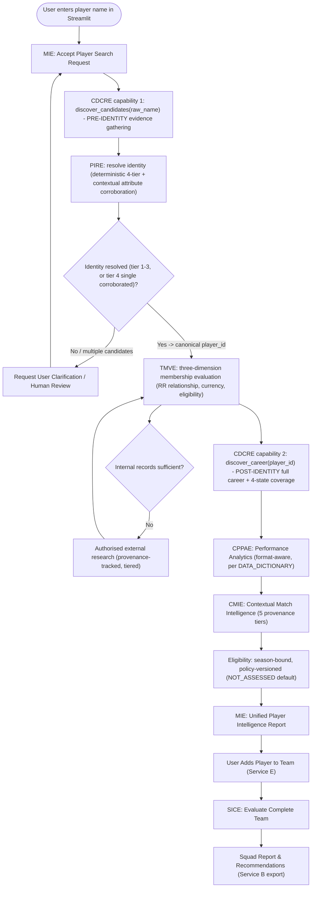
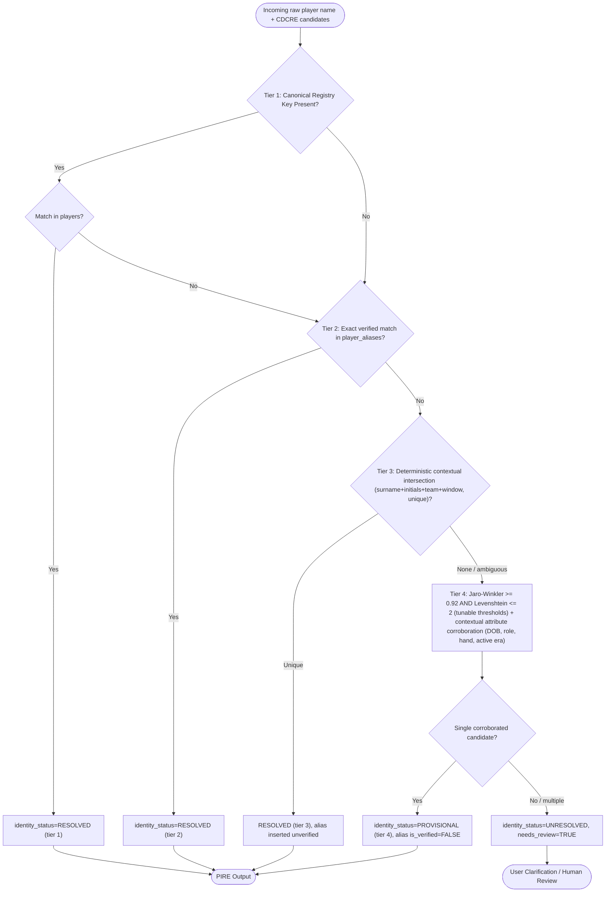
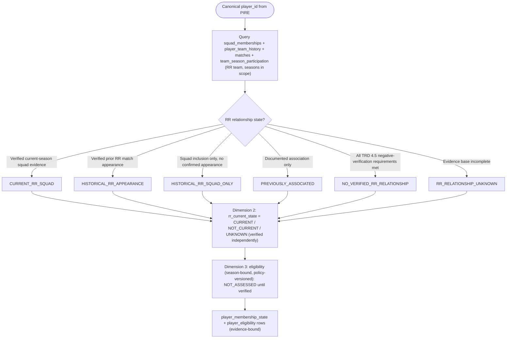
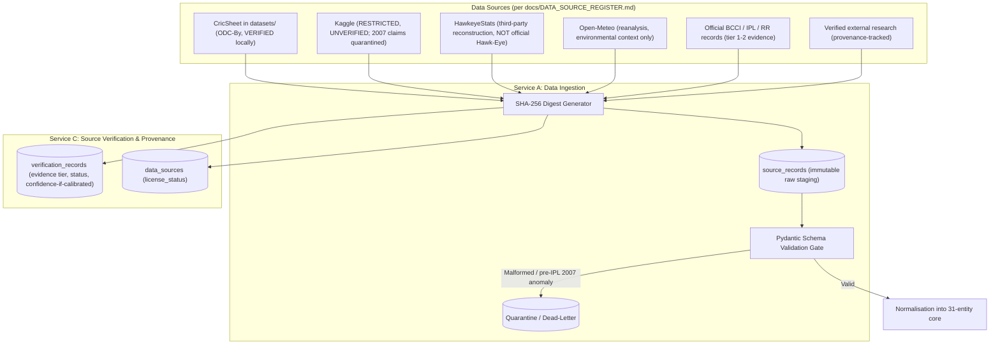
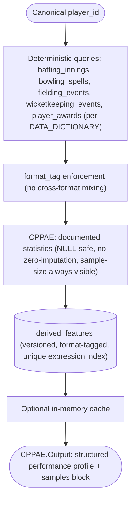
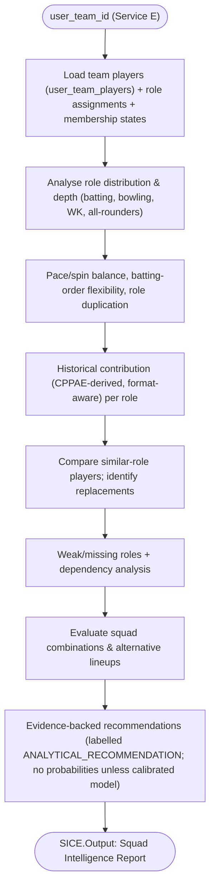
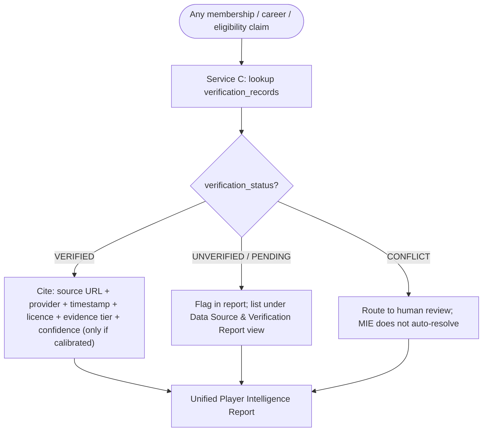

# System Architecture & Technical Design Specification
**Product**: RR Squad Intelligence & Team Composition Platform
**Focus Franchise**: Rajasthan Royals (RR) · **Primary Interface (initial)**: Streamlit
**Document Version**: 2.1.0 (ARCHITECTURE RE-REVISION)
**Status**: [STATUS: PLANNED - GREENFIELD BASELINE]
**Author**: Engineering Architecture Team (`teamwork_worker_2`)

> **Revision Note (v2.1.0, remediation)**: The data model is now **31 entities** (v2.0.0 had 27).
> The competition-level `seasons.is_suspension` model is replaced by the franchise-level
> **`team_season_participation`** entity (RR 2016–17 is a franchise suspension; IPL continued).
> Membership is modelled as **three independent dimensions** (RR relationship · current status ·
> season-bound, policy-versioned eligibility). PIRE terminology is corrected to **contextual
> attribute corroboration** (not "biometric") with deterministic tiers rather than calibrated
> probabilities. CDCRE has **two capabilities** (pre-identity candidate discovery +
> post-identity career retrieval), removing the MIE circular dependency. The ERD now matches
> the DDL 1:1 — the invalid `TEAMS`→`SEASONS` edge is gone.

---

## 1. Architectural Overview & Design Principles

> **Architecture Baseline Status**: `[STATUS: PLANNED - GREENFIELD BASELINE]`
> All diagrams and ADRs depict the approved target state. No application code exists.

The platform is an evidence-backed decision-support system: user creates a team → enters a
player name → **MIE** resolves identity, verifies RR membership across three independent
dimensions, retrieves the career, analyses performance and context, and evaluates the squad.
Guiding principles:

1. **Central Orchestration (MIE)**: coordinates the six engines, merges outputs, tracks
   verification status and provenance. Never invents statistics or membership/eligibility
   decisions.
2. **Frontend-Agnostic Engines**: typed contracts independent of any UI framework; Streamlit
   is the initial consumer; a future Next.js frontend reuses the same layer.
3. **Normalised 3NF Relational Core**: 31-entity PostgreSQL 16 schema; canonical `player_id`
   across all engines; `derived_features` is the single documented non-3NF exception.
4. **Raw / Normalised / Derived Separation**: immutable raw payloads, normalised records,
   and derived features are strictly segregated.
5. **Evidence & Provenance First**: authorised external research is provenance-tracked and
   tiered; membership/eligibility claims never rest on a single unverified source; negative
   conclusions require the documented §4.5 negative-verification requirements.
6. **Deterministic Queries**: known facts/statistics are served by deterministic database
   queries; research output is always flagged and review-gated.
7. **Franchise-Level Participation Model**: RR's 2016–17 suspension is a franchise fact
   (`team_season_participation`), never a competition-level property.

---

## 2. System Architecture Diagrams

All diagrams use Mermaid. (Validation note: no Mermaid CLI/parser is available in this
environment; diagrams were checked structurally only — see `reports/DOCUMENTATION_REMEDIATION_AUDIT.md` §13.)

### 2.1 Diagram 1: High-Level Orchestration Architecture

```mermaid
flowchart TD
    subgraph UI["Presentation Tier (Streamlit - INITIAL / Next.js FUTURE)"]
        V_TeamBuilder["Home / Team Builder"]
        V_Search["Player Search"]
        V_Verify["Identity Verification"]
        V_Membership["Historical RR Membership"]
        V_Career["Player Career Profile"]
        V_Analytics["Performance Analytics"]
        V_Context["Contextual Analysis"]
        V_Compare["Player Comparison"]
        V_Squad["Squad Composition"]
        V_Report["Squad Intelligence Report"]
        V_Provenance["Data Source & Verification Report"]
    end

    subgraph MIE["Mother Intelligence Engine (MIE) - Central Orchestrator"]
        MIE_Orchestrator["Request Router & Engine Coordinator"]
        MIE_Merge["Output Merger & Unified Report Builder"]
        MIE_Verif["Verification Status & Provenance Tracker"]
    end

    subgraph Engines["Six Specialised Engines"]
        PIRE["ENGINE 01: PIRE - Identity Resolution"]
        TMVE["ENGINE 02: TMVE - Membership Verification"]
        CDCRE["ENGINE 03: CDCRE - Candidate + Career Discovery"]
        CPPAE["ENGINE 04: CPPAE - Performance Analytics"]
        CMIE["ENGINE 05: CMIE - Contextual Match Intelligence"]
        SICE["ENGINE 06: SICE - Squad Intelligence & Composition"]
    end

    subgraph Services["Five Support Services"]
        S_Ingest["A: Data Ingestion"]
        S_ProfileGen["B: Player Profile Generator"]
        S_Provenance["C: Source Verification & Provenance"]
        S_Quality["D: Data Quality & Coverage"]
        S_TeamBuilder["E: Team Builder"]
    end

    subgraph Storage["Central PostgreSQL 16 Core (31 Entities, 3NF core)"]
        DB_Core[("players, matches, deliveries, batting_innings, ...")]
        DB_Provenance[("data_sources, source_records, verification_records")]
        DB_User[("user_teams, user_team_players")]
        DB_Features[("derived_features")]
        DB_Member[("team_season_participation, player_membership_state, player_eligibility, eligibility_policies")]
    end

    V_TeamBuilder --> MIE_Orchestrator
    V_Search --> MIE_Orchestrator
    V_Verify --> MIE_Orchestrator
    V_Membership --> MIE_Orchestrator
    V_Career --> MIE_Orchestrator
    V_Analytics --> MIE_Orchestrator
    V_Context --> MIE_Orchestrator
    V_Compare --> MIE_Orchestrator
    V_Squad --> MIE_Orchestrator
    V_Report --> MIE_Orchestrator
    V_Provenance --> MIE_Orchestrator

    MIE_Orchestrator --> PIRE
    MIE_Orchestrator --> TMVE
    MIE_Orchestrator --> CDCRE
    MIE_Orchestrator --> CPPAE
    MIE_Orchestrator --> CMIE
    MIE_Orchestrator --> SICE

    PIRE --> MIE_Merge
    TMVE --> MIE_Merge
    CDCRE --> MIE_Merge
    CPPAE --> MIE_Merge
    CMIE --> MIE_Merge
    SICE --> MIE_Merge

    MIE_Merge --> MIE_Verif
    MIE_Verif --> S_Provenance
    S_Provenance --> DB_Provenance

    PIRE --> DB_Core
    TMVE --> DB_Core
    TMVE --> DB_Member
    CDCRE --> DB_Core
    CPPAE --> DB_Core
    CMIE --> DB_Core
    SICE --> DB_Core
    SICE --> DB_User
    S_TeamBuilder --> DB_User

    S_Ingest --> DB_Provenance
    S_Ingest --> DB_Core
    S_ProfileGen --> DB_Core
    S_Quality --> DB_Core
```

### 2.2 Diagram 2: MIE Orchestration Workflow (revised — candidate discovery first)

### 2.3 Diagram 3: Player Identity Resolution (PIRE) Workflow — revised terminology

> **Terminology note**: DOB, hand, role and active era are **contextual attributes** (registry
> and cricketing data), not biometric identifiers. Tier outcomes are deterministic; numeric
> confidence is exposed only after calibration against a labelled test set (TRD §3.3).

### 2.4 Diagram 4: Team Membership Verification (TMVE) — three dimensions

> Squad inclusion alone never yields `HISTORICAL_RR_APPEARANCE`. Absence from the internal
> database alone never yields `NO_VERIFIED_RR_RELATIONSHIP` — that state requires the TRD §4.5
> documented negative-verification requirements (coverage scope, season list, squad-list +
> scorecard coverage, source quality, conflict handling, human review).

### 2.5 Diagram 5: Data Ingestion & Provenance Architecture

### 2.6 Diagram 6: Performance Analytics & Derived Feature Flow

### 2.7 Diagram 7: Central Database Entity-Relationship Diagram (31 Entities, DDL-mirrored)

```mermaid
erDiagram
    PLAYERS ||--o{ PLAYER_ALIASES : "has"
    PLAYERS ||--o{ SQUAD_MEMBERSHIPS : "belongs_to"
    PLAYERS ||--o{ PLAYER_TEAM_HISTORY : "associated_with"
    PLAYERS ||--o{ PLAYER_COMPETITION_HISTORY : "played_in"
    PLAYERS ||--o{ PLAYER_AWARDS : "received"
    PLAYERS ||--o{ PLAYER_AVAILABILITY : "tracked_in"
    PLAYERS ||--o{ PLAYER_INJURIES : "affected_by"
    PLAYERS ||--o{ PLAYER_MEMBERSHIP_STATE : "evaluated_in"
    PLAYERS ||--o{ PLAYER_ELIGIBILITY : "assessed_in"
    PLAYERS ||--o{ BATTING_INNINGS : "bats_in"
    PLAYERS ||--o{ BOWLING_SPELLS : "bowls_in"
    PLAYERS ||--o{ FIELDING_EVENTS : "fields_in"
    PLAYERS ||--o{ WICKETKEEPING_EVENTS : "keeps_in"
    PLAYERS ||--o{ DELIVERIES : "bats_bowls_in"
    PLAYERS ||--o{ DERIVED_FEATURES : "evaluated_by"
    PLAYERS ||--o{ USER_TEAM_PLAYERS : "selected_in"
    TEAMS ||--o{ SQUAD_MEMBERSHIPS : "contracts"
    TEAMS ||--o{ PLAYER_TEAM_HISTORY : "linked_to"
    TEAMS ||--o{ TEAM_SEASON_PARTICIPATION : "participates"
    TEAMS ||--o{ MATCHES : "plays_home_away"
    TEAMS ||--o{ INNINGS : "bats_or_bowls"
    COMPETITIONS ||--o{ SEASONS : "has_edition"
    SEASONS ||--o{ TEAM_SEASON_PARTICIPATION : "editions"
    SEASONS ||--o{ SQUAD_MEMBERSHIPS : "applies_to"
    SEASONS ||--o{ MATCHES : "contains"
    SEASONS ||--o{ PLAYER_AVAILABILITY : "season_of"
    SEASONS ||--o{ PLAYER_ELIGIBILITY : "eligibility_season"
    SEASONS ||--o{ ELIGIBILITY_POLICIES : "governs"
    VENUES ||--o{ TEAMS : "home_venue_of"
    VENUES ||--o{ MATCHES : "hosts"
    VENUES ||--o{ PITCH_CONDITIONS : "surface"
    MATCHES ||--o{ INNINGS : "comprises"
    MATCHES ||--o{ PITCH_CONDITIONS : "has_conditions"
    MATCHES ||--o{ WEATHER_CONDITIONS : "experiences"
    MATCHES ||--o{ WICKETKEEPING_EVENTS : "records_keeper"
    MATCHES ||--o{ PLAYER_AWARDS : "awards"
    INNINGS ||--o{ DELIVERIES : "contains_delivery_events"
    INNINGS ||--o{ BATTING_INNINGS : "records_batting"
    INNINGS ||--o{ BOWLING_SPELLS : "records_bowling"
    INNINGS ||--o{ WICKETKEEPING_EVENTS : "records_wk"
    DELIVERIES ||--o{ FIELDING_EVENTS : "results_in (delivery_id, season_year)"
    USER_TEAMS ||--o{ USER_TEAM_PLAYERS : "contains"
    USER_TEAM_PLAYERS }o--|| PLAYERS : "references"
    DATA_SOURCES ||--o{ SOURCE_RECORDS : "provides"
    DATA_SOURCES ||--o{ VERIFICATION_RECORDS : "evidenced_by"
    DATA_SOURCES ||--o{ TEAM_SEASON_PARTICIPATION : "evidence_source"
    SOURCE_RECORDS ||--o{ VERIFICATION_RECORDS : "cited_in"
    SOURCE_RECORDS ||--o{ DELIVERIES : "provenance_of"
    SOURCE_RECORDS ||--o{ PITCH_CONDITIONS : "provenance_of"
    SOURCE_RECORDS ||--o{ WEATHER_CONDITIONS : "provenance_source"
    SOURCE_RECORDS ||--o{ MATCHES : "ingested_as"
    ELIGIBILITY_POLICIES ||--o{ PLAYER_ELIGIBILITY : "version_of"
    PLAYER_TEAM_HISTORY }o--|| SOURCE_RECORDS : "provenance"
    PLAYER_COMPETITION_HISTORY }o--|| SOURCE_RECORDS : "provenance"
    PLAYER_MEMBERSHIP_STATE }o--|| VERIFICATION_RECORDS : "evidence"
```

> The **31 entities**: `players`, `player_aliases`, `teams`, `venues`, `competitions`,
> `seasons`, `team_season_participation`, `squad_memberships`, `player_team_history`,
> `matches`, `innings`, `deliveries`, `batting_innings`, `bowling_spells`, `fielding_events`,
> `wicketkeeping_events`, `pitch_conditions`, `weather_conditions`, `player_availability`,
> `player_injuries`, `player_awards`, `player_competition_history`, `player_membership_state`,
> `eligibility_policies`, `player_eligibility`, `user_teams`, `user_team_players`,
> `data_sources`, `source_records`, `verification_records`, `derived_features`.
>
> **The `TEAMS → SEASONS` edge has been removed** (it existed in no DDL); teams relate to
> seasons through `team_season_participation` (one participation row per team+season,
> `PARTICIPATING`/`SUSPENDED`/`NOT_ENTERED`/`UNKNOWN`).
> Full DDL, PK/FK/cardinality/nullability/referential-action details: `docs/TRD.md §10`.

### 2.8 Diagram 8: Squad Intelligence & Composition (SICE) Evaluation Flow

### 2.9 Diagram 9: Streamlit Presentation Tier

### 2.10 Diagram 10: Evidence & Verification Flow (MIE → Provenance)

---

## 3. Architectural Decision Records (ADRs)

### ADR-001: PostgreSQL 16 normalised core with season partitioning
- **Status**: APPROVED TARGET `[STATUS: PLANNED - GREENFIELD BASELINE]`
- **Context**: The engine analyses >250,000 delivery events across 2008–2026 plus
  multi-competition career data. A document store risks inconsistent player names and broken
  joins.
- **Decision**: PostgreSQL 16 normalised 3NF core across 31 entities; `deliveries` partitioned
  by `season_year` (partitions through 2027).
- **Consequences**: referential integrity (including FKs on the partitioned `deliveries`
  table, supported since PG 15), partition pruning, stable canonical `player_id`.

### ADR-002: Mother Intelligence Engine as the single orchestration point
- **Status**: APPROVED TARGET
- **Context**: Engines invoked directly by the UI created ad-hoc sequencing and inconsistent
  merging, and a circular dependency between PIRE (needs external evidence) and CDCRE
  (required a resolved player_id).
- **Decision**: A central MIE accepts search requests, sequences **CDCRE candidate discovery →
  PIRE → TMVE → CDCRE career → CPPAE → CMIE → SICE**, merges outputs, tracks verification
  status and provenance, and returns a single structured report. MIE never invents statistics
  or makes membership/eligibility decisions.
- **Consequences**: deterministic orchestration, single audit point, stable contracts.

### ADR-003: Frontend-agnostic engine contracts (Streamlit now, Next.js later)
- **Status**: APPROVED TARGET
- **Decision**: All engines and MIE expose typed, versioned, UI-independent contracts;
  Streamlit sessions never perform analytics; a future Next.js layer consumes identical
  contracts.
- **Consequences**: UI swaps do not require re-architecting analytics.

### ADR-004: Franchise-level team-season participation (replaces competition-level suspension flag)
- **Status**: APPROVED TARGET
- **Context**: RR's 2016–2017 suspension was franchise-specific; the IPL competition continued
  for all other teams. A competition-wide `seasons.is_suspension` flag was therefore the wrong
  model.
- **Decision**: `team_season_participation` (team_id + season_id → `PARTICIPATING` /
  `SUSPENDED` / `NOT_ENTERED` / `UNKNOWN` with evidence source and verification status, one row
  per team+season). RR×IPL 2016 and RR×IPL 2017 = `SUSPENDED`/verified; IPL 2016/2017 seasons
  exist normally; RR×IPL 2027 = `UNKNOWN` until authoritative squad evidence is verified.
- **Consequences**: suspension facts are franchise-scoped, auditable, and independent of
  competition-wide season data.

### ADR-005: Three-dimension membership + season-bound versioned eligibility (replaces conflated six-class taxonomy)
- **Status**: APPROVED TARGET
- **Context**: The six-class taxonomy conflated RR relationship, currency, and uncapped
  eligibility into one label, so a verified ex-RR player with a separately assessed
  uncapped-eligibility had no representation, and unknown players risked auto-"uncapped"
  labelling.
- **Decision**: `player_membership_state` stores RR relationship (6 states) and current status
  (`CURRENT`/`NOT_CURRENT`/`UNKNOWN`); `player_eligibility` stores season-bound
  `VERIFIED_ELIGIBLE`/`VERIFIED_NOT_ELIGIBLE`/`ELIGIBILITY_UNVERIFIED`/`NOT_ASSESSED` against a
  versioned `eligibility_policies` row (BCCI/IPL rule source, effective dates, independently
  verified). Negative classification requires the documented TRD §4.5 requirements.
- **Consequences**: dimensions are independently auditable; no unknown→uncapped assumption.

### ADR-006: Deterministic queries first; LLM-optional, flagged research
- **Status**: APPROVED TARGET
- **Decision**: Known facts/statistics come from deterministic database queries. External
  research (LLM-assisted where useful) is evidence discovery/verification only; its output is
  flagged third-party-estimate / model-inferred, provenance-tracked, and routed to human
  review when it affects identity, membership, or eligibility. No engine depends on an LLM.
- **Consequences**: reproducible core; research stays isolated, flagged, auditable.

### ADR-007: PIRE deterministic tiers with contextual attribute corroboration
- **Status**: APPROVED TARGET
- **Context**: v2.0.0 described Tier 4 corroboration (DOB, hand, era) as "biometric" and
  presented 1.000/0.980/0.950 scores as calibrated probabilities — neither is correct:
  cricketing/registry attributes are not biometrics, and the constants were tuning
  thresholds, not calibrated probabilities.
- **Decision**: Tier outcomes are deterministic (`RESOLVED`/`PROVISIONAL`/`UNRESOLVED` +
  tier id + evidence). Fuzzy thresholds (Jaro-Winkler ≥ 0.92, Levenshtein ≤ 2) are
  configuration parameters. A numeric `confidence` is exposed only after calibration
  against a labelled identity-resolution test set (`calibrated=TRUE`). Identity, membership,
  coverage, and eligibility confidences are separate measurements reported by separate
  engines.
- **Consequences**: no false precision; every exposed number is defensible.

---

## 4. Verification & Architecture Integrity

1. **Syntax validation (honest statement)**: no Mermaid CLI/parser is available in this
   environment. Diagrams were lint-checked structurally (unique node ids, edge syntax,
   balanced fences) but **not** parser-validated. A Mermaid lint gate (e.g.,
   `@mermaid-js/mermaid-cli`) is a Phase 9 checkpoint.
2. **Schema integrity**: the 31-entity DDL in `docs/TRD.md §10` passes a sqlglot
   PostgreSQL-dialect parse with zero errors; all FK target tables are defined; partition-key
   composite PK is respected. (No live PostgreSQL execution available — recorded limitation;
   Phase 2 gate covers execution.)
3. **ERD ↔ DDL**: every ERD edge corresponds to a DDL relationship (§2.7 note); the invalid
   `TEAMS → SEASONS` edge was removed.
4. **Cross-document consistency**: terminology, entity count (31), three-dimension
   membership, eligibility policy model, engine names, and `agent_cdcre` identifier match
   across `PRD.md`, `TRD.md`, `ARCHITECTURE.md`, `PHASES.md`, `AGENTS.md`,
   `AI_INSTRUCTIONS.md`, `README.md`, `PROJECT.md`, and `docs/README.md`.
