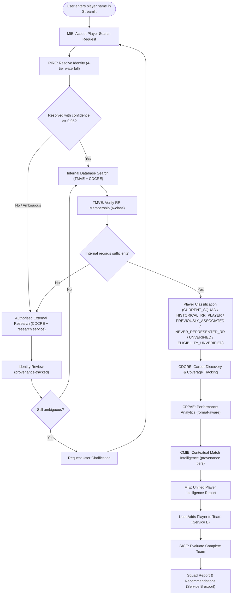
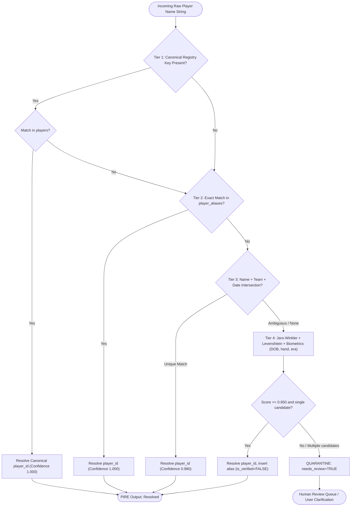
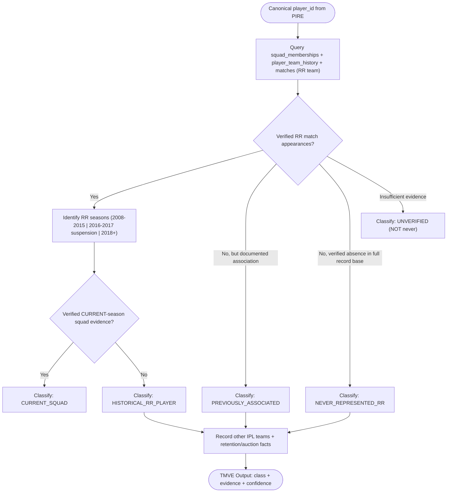
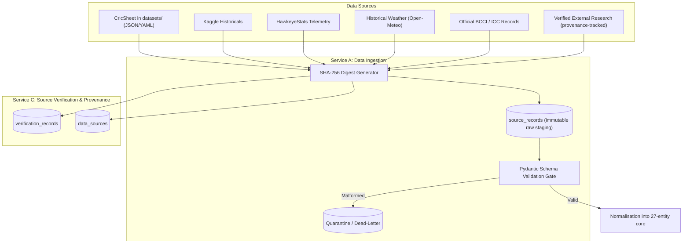
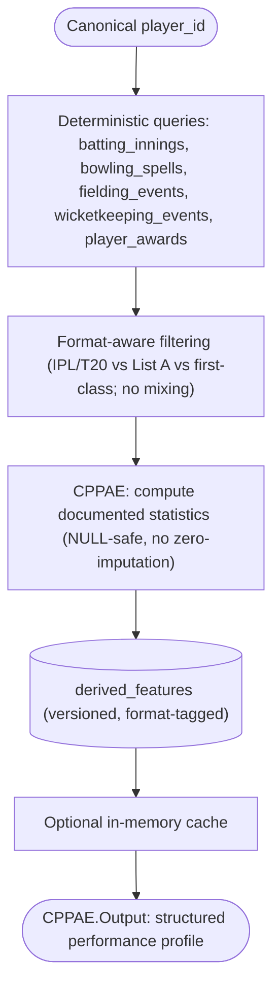
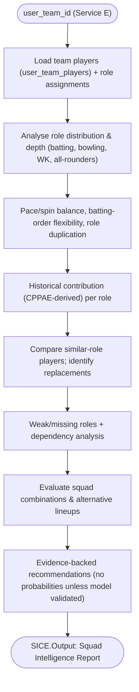
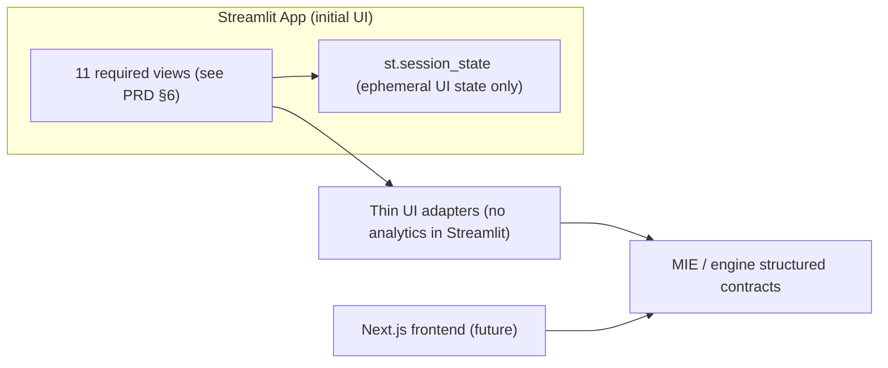
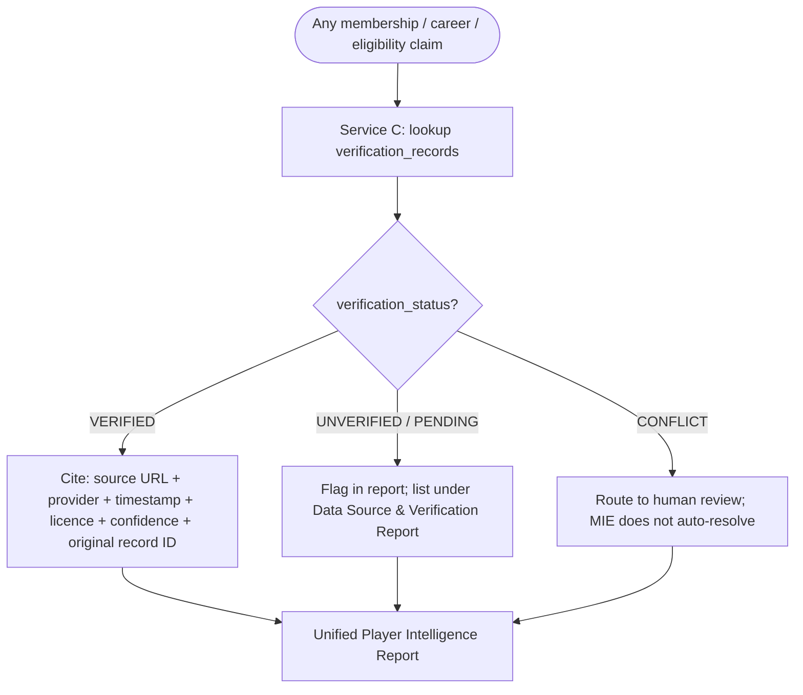

# System Architecture & Technical Design Specification
**Product**: RR Squad Intelligence & Team Composition Platform
**Focus Franchise**: Rajasthan Royals (RR) · **Primary Interface (initial)**: Streamlit
**Document Version**: 2.0.0 (ARCHITECTURE REVISION)
**Status**: [STATUS: PLANNED - GREENFIELD BASELINE]
**Author**: Engineering Architecture Team (`teamwork_worker_2`)

> **Revision Note (v2.0.0)**: The architecture has been re-centred on the **Mother
> Intelligence Engine (MIE)** orchestrating **six specialised engines** (PIRE, TMVE, CDCRE,
> CPPAE, CMIE, SICE) and **five support services**, with a **Streamlit** initial frontend that
> is strictly separated from the analytical core. The raw data directory is `datasets/`
> (previously `CricSheet/`). The central database now spans **27 entities**. Engines expose
> frontend-agnostic contracts so a future Next.js frontend can reuse them unchanged.

---

## 1. Architectural Overview & Design Principles

> **Architecture Baseline Status**: `[STATUS: PLANNED - GREENFIELD BASELINE]`
> All diagrams and Architectural Decision Records (ADRs) depict the approved target state.

The RR Squad Intelligence & Team Composition Platform is an evidence-backed decision-support
system. Its workflow: user creates a team → enters a player name → MIE resolves identity,
verifies RR membership, discovers the career, analyses performance, adds contextual
intelligence, and evaluates the assembled squad. The architecture is guided by seven principles:

1. **Central Orchestration (MIE)**: A single Mother Intelligence Engine coordinates the six
   specialised engines, merges their outputs, and returns structured responses. MIE never
   invents statistics or makes unsupported membership decisions.
2. **Frontend-Agnostic Engines**: Every engine and MIE exposes typed input/output contracts
   independent of any UI framework. Streamlit is the **initial** consumer; a future Next.js
   frontend reuses the same layer.
3. **Strict 3NF Relational Core**: A 27-entity PostgreSQL 16 schema enforces referential
   integrity; canonical `player_id` is used across all engines.
4. **Raw / Normalised / Derived Separation**: immutable raw payloads, normalised records, and
   `derived_features` are strictly segregated.
5. **Evidence & Provenance First**: external research is authorised, provenance-tracked, and
   verification-statused; membership/eligibility claims never rest on a single unverified source.
6. **Deterministic Queries**: known facts and statistics are served by deterministic database
   queries; external research is used only for evidence discovery and verification.
7. **No LLM-Dependency for Correctness**: no engine requires an LLM on its deterministic path;
   LLM-assisted research output is always flagged (third-party estimate / model-inferred) and
   routed for human review when it affects identity, membership, or eligibility.

---

## 2. System Architecture Diagrams

All diagrams use Mermaid. Node identifiers avoid reserved keywords; edges are explicit.

### 2.1 Diagram 1: High-Level Orchestration Architecture

```mermaid
flowchart TD
    subgraph UI["Presentation Tier (Streamlit - INITIAL / Next.js FUTURE)"]
        V_TeamBuilder["Home / Team Builder"]
        V_Search["Player Search"]
        V_Verify["Identity Verification"]
        V_Membership["Historical RR Membership"]
        V_Career["Player Career Profile"]
        V_Analytics["Performance Analytics"]
        V_Context["Contextual Analysis"]
        V_Compare["Player Comparison"]
        V_Squad["Squad Composition"]
        V_Report["Squad Intelligence Report"]
        V_Provenance["Data Source & Verification Report"]
    end

    subgraph MIE["Mother Intelligence Engine (MIE) - Central Orchestrator"]
        MIE_Orchestrator["Request Router & Engine Coordinator"]
        MIE_Merge["Output Merger & Unified Report Builder"]
        MIE_Verif["Verification Status & Provenance Tracker"]
    end

    subgraph Engines["Six Specialised Engines"]
        PIRE["ENGINE 01: PIRE - Identity Resolution"]
        TMVE["ENGINE 02: TMVE - Membership Verification"]
        CDCRE["ENGINE 03: CDCRE - Career Discovery"]
        CPPAE["ENGINE 04: CPPAE - Performance Analytics"]
        CMIE["ENGINE 05: CMIE - Contextual Match Intelligence"]
        SICE["ENGINE 06: SICE - Squad Intelligence & Composition"]
    end

    subgraph Services["Five Support Services"]
        S_Ingest["A: Data Ingestion"]
        S_ProfileGen["B: Player Profile Generator"]
        S_Provenance["C: Source Verification & Provenance"]
        S_Quality["D: Data Quality & Coverage"]
        S_TeamBuilder["E: Team Builder"]
    end

    subgraph Storage["Central PostgreSQL 16 Core (27 Entities, 3NF)"]
        DB_Core[("players, matches, deliveries, batting_innings, ...")]
        DB_Provenance[("data_sources, source_records, verification_records")]
        DB_User[("user_teams, user_team_players")]
        DB_Features[("derived_features")]
    end

    V_TeamBuilder --> MIE_Orchestrator
    V_Search --> MIE_Orchestrator
    V_Verify --> MIE_Orchestrator
    V_Membership --> MIE_Orchestrator
    V_Career --> MIE_Orchestrator
    V_Analytics --> MIE_Orchestrator
    V_Context --> MIE_Orchestrator
    V_Compare --> MIE_Orchestrator
    V_Squad --> MIE_Orchestrator
    V_Report --> MIE_Orchestrator
    V_Provenance --> MIE_Orchestrator

    MIE_Orchestrator --> PIRE
    MIE_Orchestrator --> TMVE
    MIE_Orchestrator --> CDCRE
    MIE_Orchestrator --> CPPAE
    MIE_Orchestrator --> CMIE
    MIE_Orchestrator --> SICE

    PIRE --> MIE_Merge
    TMVE --> MIE_Merge
    CDCRE --> MIE_Merge
    CPPAE --> MIE_Merge
    CMIE --> MIE_Merge
    SICE --> MIE_Merge

    MIE_Merge --> MIE_Verif
    MIE_Verif --> S_Provenance
    S_Provenance --> DB_Provenance

    PIRE --> DB_Core
    TMVE --> DB_Core
    CDCRE --> DB_Core
    CPPAE --> DB_Core
    CMIE --> DB_Core
    SICE --> DB_Core
    SICE --> DB_User
    S_TeamBuilder --> DB_User

    S_Ingest --> DB_Provenance
    S_Ingest --> DB_Core
    S_ProfileGen --> DB_Core
    S_Quality --> DB_Core
```

### 2.2 Diagram 2: MIE Orchestration Workflow (End-to-End Player Intelligence)

### 2.3 Diagram 3: Player Identity Resolution (PIRE) Workflow

### 2.4 Diagram 4: Team Membership Verification (TMVE) Decision Flow

### 2.5 Diagram 5: Data Ingestion & Provenance Architecture

### 2.6 Diagram 6: Performance Analytics & Derived Feature Flow

### 2.7 Diagram 7: Central Database Entity-Relationship Diagram (27 Entities)

```mermaid
erDiagram
    PLAYERS ||--o{ PLAYER_ALIASES : "has"
    PLAYERS ||--o{ SQUAD_MEMBERSHIPS : "belongs_to"
    PLAYERS ||--o{ PLAYER_TEAM_HISTORY : "associated_with"
    PLAYERS ||--o{ PLAYER_COMPETITION_HISTORY : "played_in"
    PLAYERS ||--o{ PLAYER_AWARDS : "received"
    PLAYERS ||--o{ PLAYER_AVAILABILITY : "tracked_in"
    PLAYERS ||--o{ PLAYER_INJURIES : "affected_by"
    PLAYERS ||--o{ BATTING_INNINGS : "bats_in"
    PLAYERS ||--o{ BOWLING_SPELLS : "bowls_in"
    PLAYERS ||--o{ FIELDING_EVENTS : "fields_in"
    PLAYERS ||--o{ WICKETKEEPING_EVENTS : "keeps_in"
    PLAYERS ||--o{ DERIVED_FEATURES : "evaluated_in"
    PLAYERS ||--o{ USER_TEAM_PLAYERS : "selected_in"
    TEAMS ||--o{ SQUAD_MEMBERSHIPS : "contracts"
    TEAMS ||--o{ PLAYER_TEAM_HISTORY : "linked_to"
    TEAMS ||--o{ MATCHES : "plays"
    TEAMS ||--o{ INNINGS : "bats_bowls"
    TEAMS ||--o{ SEASONS : "competes_in"
    COMPETITIONS ||--o{ SEASONS : "has"
    COMPETITIONS ||--o{ PLAYER_COMPETITION_HISTORY : "context_of"
    SEASONS ||--o{ SQUAD_MEMBERSHIPS : "applies_to"
    SEASONS ||--o{ MATCHES : "contains"
    VENUES ||--o{ MATCHES : "hosts"
    VENUES ||--o{ PITCH_CONDITIONS : "has_surface"
    MATCHES ||--o{ INNINGS : "comprises"
    MATCHES ||--o{ PITCH_CONDITIONS : "has_surface_match"
    MATCHES ||--o{ WEATHER_CONDITIONS : "experiences"
    MATCHES ||--o{ FIELDING_EVENTS : "includes"
    MATCHES ||--o{ WICKETKEEPING_EVENTS : "includes"
    INNINGS ||--o{ DELIVERIES : "contains_balls"
    INNINGS ||--o{ BATTING_INNINGS : "records_batting"
    INNINGS ||--o{ BOWLING_SPELLS : "records_bowling"
    INNINGS ||--o{ WICKETKEEPING_EVENTS : "records_wk"
    DELIVERIES ||--o{ FIELDING_EVENTS : "results_in"
    USER_TEAMS ||--o{ USER_TEAM_PLAYERS : "contains"
    DATA_SOURCES ||--o{ SOURCE_RECORDS : "provides"
    DATA_SOURCES ||--o{ VERIFICATION_RECORDS : "backed_by"
    SOURCE_RECORDS ||--o{ VERIFICATION_RECORDS : "evidenced_in"
    PLAYER_TEAM_HISTORY }o--|| DATA_SOURCES : "evidence_source"
    PLAYER_COMPETITION_HISTORY }o--|| SOURCE_RECORDS : "provenance"
```

> The 27 entities: `players`, `player_aliases`, `teams`, `competitions`, `seasons`,
> `squad_memberships`, `player_team_history`, `matches`, `innings`, `deliveries`,
> `batting_innings`, `bowling_spells`, `fielding_events`, `wicketkeeping_events`, `venues`,
> `pitch_conditions`, `weather_conditions`, `player_availability`, `player_injuries`,
> `player_awards`, `player_competition_history`, `user_teams`, `user_team_players`,
> `data_sources`, `source_records`, `verification_records`, `derived_features`.
> Full DDL, PK/FK/index definitions: `docs/TRD.md §10`.

### 2.8 Diagram 8: Squad Intelligence & Composition (SICE) Evaluation Flow

### 2.9 Diagram 9: Streamlit Presentation Tier

### 2.10 Diagram 10: Evidence & Verification Flow (MIE → Provenance)

---

## 3. Architectural Decision Records (ADRs)

### ADR-001: PostgreSQL 16 3NF Core with Season Partitioning
- **Status**: APPROVED TARGET `[STATUS: PLANNED]`
- **Context**: The engine analyses >250,000 delivery rows across 2008–2026 plus multi-competition
  career data. A document store risks inconsistent player names and broken joins.
- **Decision**: PostgreSQL 16 3NF across 27 entities; `deliveries` partitioned by
  `season_year` (including a 2024–2027 partition to admit a future 2027 season).
- **Consequences**: referential integrity, partition pruning, and a stable canonical `player_id`.

### ADR-002: Mother Intelligence Engine as the Single Orchestration Point
- **Status**: APPROVED TARGET
- **Context**: Prior design had engines invoked directly by the UI, creating ad-hoc sequencing
  and inconsistent merging.
- **Decision**: A central MIE accepts search requests, coordinates all six engines in a fixed
  dependency order, merges outputs, tracks verification status, and returns a single structured
  report. MIE never invents statistics or makes membership decisions.
- **Consequences**: deterministic orchestration, single audit point, engine contracts stable.

### ADR-003: Frontend-Agnostic Engine Contracts (Streamlit now, Next.js later)
- **Status**: APPROVED TARGET
- **Context**: The initial product ships as a Streamlit application, but the analytical core must
  outlive that UI.
- **Decision**: All engines and MIE expose typed, versioned, UI-independent contracts. Streamlit
  sessions never perform analytics; a future Next.js layer consumes identical contracts.
- **Consequences**: no engine imports a UI framework; UI swaps do not require re-architecting
  analytics.

### ADR-004: Four-State Coverage + Six-Class Membership to Prevent False Negatives
- **Status**: APPROVED TARGET
- **Context**: Naïve absence-of-data reads create false "never played RR" / "uncapped" labels.
- **Decision**: `player_competition_history.coverage_status` uses four states
  (verified / dataset-unavailable / not-established / confirmed-non-participation); TMVE uses a
  six-class membership taxonomy where "insufficient evidence" maps to `UNVERIFIED`, never to
  `NEVER_REPRESENTED_RR`.
- **Consequences**: unknowns are surfaced for review instead of silently misclassified.

### ADR-005: Evidence & Provenance Records with Verification Status
- **Status**: APPROVED TARGET
- **Context**: Authorised external research is required, but unverified external claims must not
  masquerade as verified facts.
- **Decision**: `verification_records` + `data_sources` capture source URL, provider, retrieval
  timestamp, licence, verification status, confidence, and original record ID. MIE tracks
  verification status and routes CONFLICT to human review.
- **Consequences**: every external claim is auditable and licence-compliant.

### ADR-006: Deterministic Queries First, LLM-Optional Research
- **Status**: APPROVED TARGET
- **Context**: Making every engine depend on an LLM is fragile, non-reproducible, and costly.
- **Decision**: Known facts and statistics are served by deterministic database queries.
  External research (with LLM assistance where useful) is used only for evidence discovery and
  verification; such output is flagged third-party-estimate / model-inferred and requires
  human review when it affects identity, membership, or eligibility.
- **Consequences**: reproducible core; research stays isolated, flagged, and auditable.

### ADR-007: RR Suspension Period Represented as a First-Class State
- **Status**: APPROVED TARGET
- **Context**: RR were suspended for IPL 2016–2017 and returned in 2018; naive season
  enumeration would misclassify the gap.
- **Decision**: `seasons.is_suspension` flag plus TMVE segmentation (2008–2015 / suspension /
  2018+ / 2027-future). No squad data is generated for suspension years without the flag.
- **Consequences**: membership analysis is historically accurate and judge-auditable.

---

## 4. Verification & Architecture Integrity

1. **Syntax Validation**: All Mermaid diagrams validated against Mermaid parser rules; node
   identifiers unique, edges explicit.
2. **Relational Completeness**: The ERD (Diagram 7) mirrors the 27-entity DDL in
   `docs/TRD.md §10` (PKs, FKs, cardinalities).
3. **Contract Consistency**: Engine I/O contracts in `docs/TRD.md §3–§13` match MIE orchestration
   (Diagram 2) and the SICE flow (Diagram 8).
4. **Cross-Document Consistency**: Terminology, entity names, and the six-class membership
   taxonomy match across `PRD.md`, `TRD.md`, `ARCHITECTURE.md`, `PHASES.md`, `AGENTS.md`, and
   `AI_INSTRUCTIONS.md`.
5. **Streamlit Independence Check**: An automated import test confirms no engine module imports
   Streamlit (see PRD AC-13).
